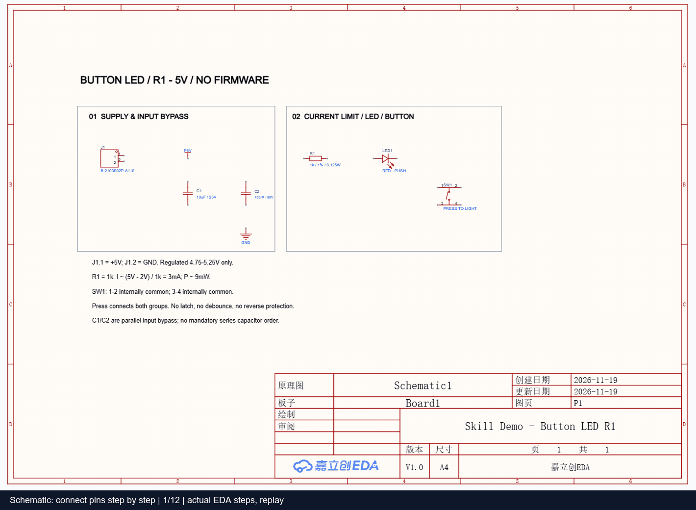
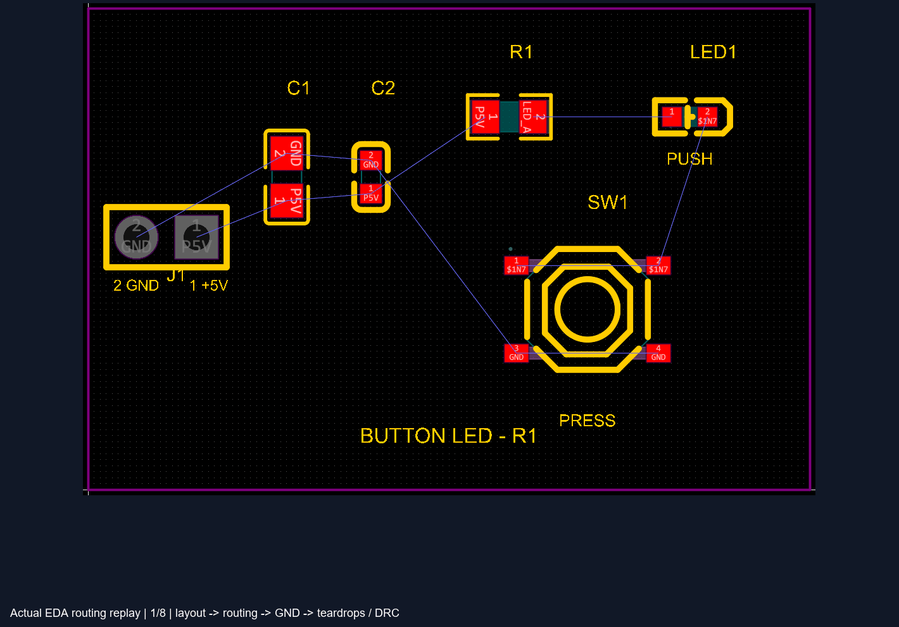
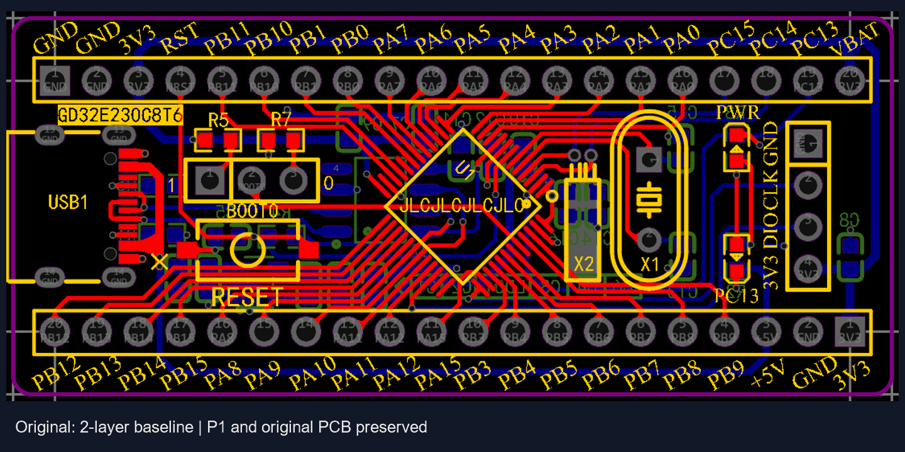
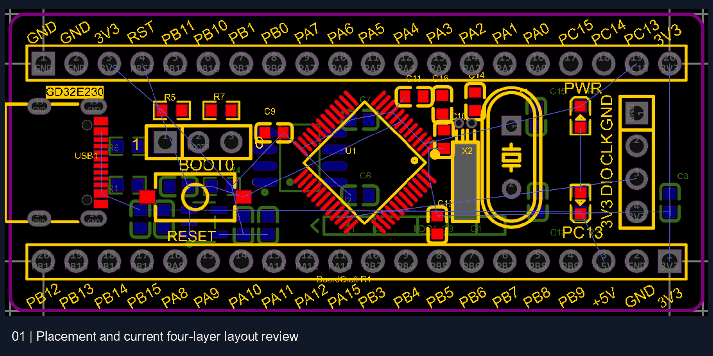

# BoardCraft

**Clear schematics. Deliberate PCB layouts. Traceable evidence.**

[中文](README.md) · [Installation](docs/INSTALLATION.md) · [Changelog](CHANGELOG.md) · [Tools](docs/TOOLS.md)

BoardCraft is the shorter name for `embedded-hardware-design`. It supplies task-specific hardware rules, review templates and evidence checks. Existing SCH/PCB rule IDs are preserved. EasyEDA is the primary live editor; this Skill does not provide an editor or certify hardware.

## Start

Download `boardcraft.zip` from the [existing v3 release page](https://github.com/mengqy2022/boardcraft/releases/tag/v3.0.0), back up the previous installation, and follow the [migration guide](docs/INSTALLATION.md).

```text
Use $boardcraft for the current EasyEDA project.
Inspect the actual components, nets, layer stack and locked mechanical baseline.
Preserve the original, review placement and each supply/return loop before routing.
Deliver current-revision checks, evidence and explicitly unmeasured items.
```

For ordinary ChatGPT, upload `BOARDCRAFT_CHATGPT.md` with the project constraints. It carries rules, not live EDA access.

## Learn by example

| Example | What it exercises |
|---|---|
| [Button LED board](docs/DEMO.md) | Components, electrical calculations, schematic, two-layer PCB, real wiring GIFs and honest capability assessment |
| [GD32E230 PCB comparison](docs/GD32E230.md) | Preserve the schematic/outline, review MCU decoupling and crystals, compare the baseline with a separate PCB revision |

### 01 · Button LED board

| Schematic wiring | PCB routing |
|---|---|
|  |  |

### 02 · GD32E230 development board

| Original and BoardCraft variant | Placement and routing process |
|---|---|
|  |  |

## Use only applicable rules

Read the current design, classify each component/net with evidence, and generate a task rule profile. Core PCB stages include assembly, supply/return, silkscreen and verification; differential/high-speed, crystals, analog, switching power, multilayer, RF and FPC activate when the actual design requires them. Unknown classifications remain unresolved. [Guide](docs/V3_GUIDE.md) · [Routing contract](references/task-routing.md)

Rule routing, stage evidence, workspace gates, native DRC and engineering reviews serve different purposes. Zero DRC errors do not certify decoupling, impedance, return paths, manufacturability or measured performance. [Verification](references/verification.md)

## Tools

[Tools and upstream links](docs/TOOLS.md) explain EasyEDA API/Bridge, [drawio-engineering-mcp](https://github.com/RFingAdam/drawio-engineering-mcp), [rftools-mcp](https://www.npmjs.com/package/rftools-mcp), [Ponytail](https://github.com/DietrichGebert/ponytail) and [mattpocock-skills](https://github.com/mattpocock/skills). Installation, invocation and verified capabilities are separate; optional plugins are not bundled or automatically executed.

## Current edition

<!-- release:start -->
**[v3.0.1](https://github.com/mengqy2022/boardcraft/releases/tag/v3.0.0) · 2026-11-19**

- Rename to **BoardCraft**, invoked as `$boardcraft`, preserving the existing rule IDs, evidence gates and migration history.
- Add a PCB-only GD32E230 development-board comparison, protecting the original schematic/PCB and matching the board outline and interface baseline; include cropped GIFs and evidence-based differences.
- Simplify bilingual navigation and document EasyEDA tooling, drawio-engineering-mcp, rftools, Ponytail and mattpocock-skills with upstream links and limitations.
- Refresh the existing v3.0.0 release page at the user's explicit request after archiving previous assets. Keep the original tag immutable and identify the 3.0.1 attachment edition and source commit separately; create no new Release.
- Keep calculations, native EDA checks, manufacturing review and unmeasured prototype performance distinct.

[All changes](CHANGELOG.md) · [Release assets and checksums](https://github.com/mengqy2022/boardcraft/releases/tag/v3.0.0)
<!-- release:end -->

This update refreshes attachments on the existing v3 page at the user's request. Original assets are archived, the original tag remains immutable, and the new attachment edition/source commit is recorded separately. No extra Release page is created.

[Contributing](CONTRIBUTING.md) · [Releasing](docs/RELEASING.md) · [Sources](references/sources.md) · [License](LICENSE)
