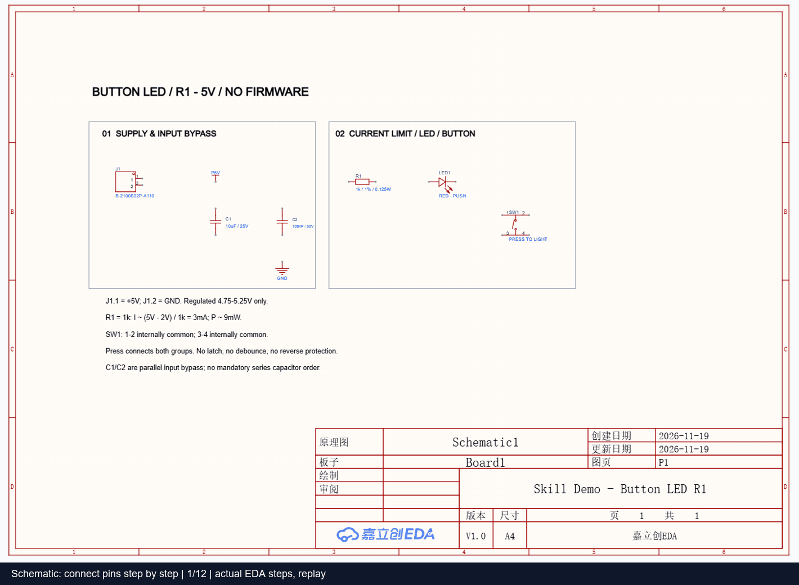
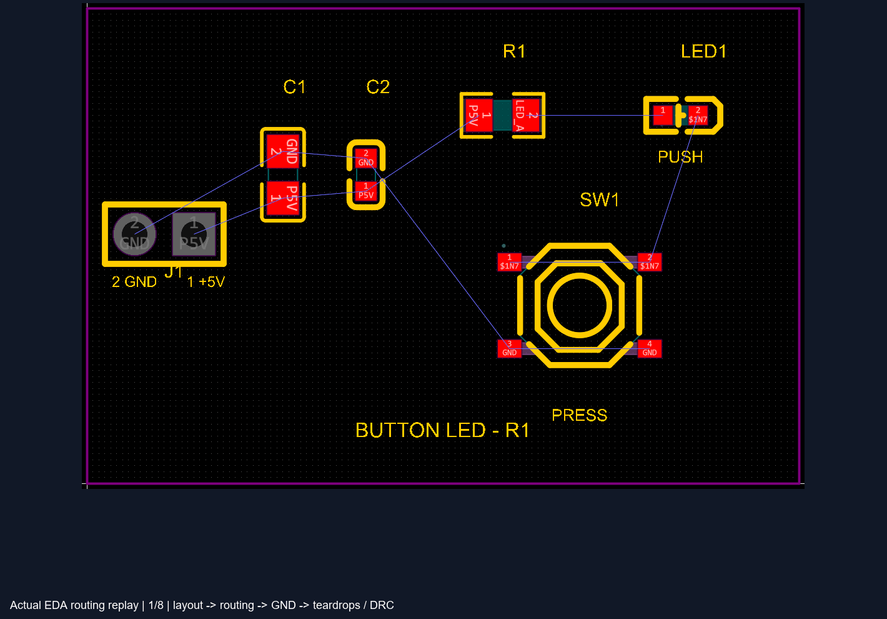
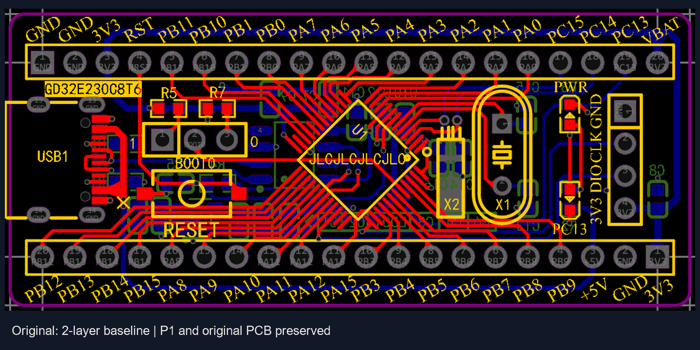
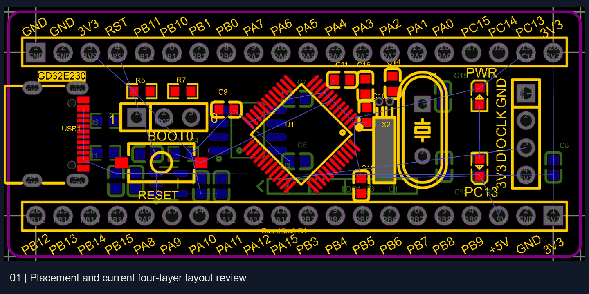

<div align="center">


# BoardCraft · 板匠

**把电路意图，变成清楚的原理图和有据可查的 PCB。**

[](https://github.com/mengqy2022/boardcraft/actions/workflows/ci.yml)
[](LICENSE)

**中文** · [English](README.en.md) · [安装与迁移](docs/INSTALLATION.md) · [更新记录](CHANGELOG.md)

</div>

BoardCraft 是面向 AI 辅助硬件设计的 Skill：组织设计规则、选择适用模块、记录工程证据。原名 `embedded-hardware-design`，规则编号和已验证的方法延续。主要用于嘉立创EDA专业版，实际编辑由连接的 EDA 工具完成。

## 先开始，再按需深入

1. 从[现有 v3 发布页](https://github.com/mengqy2022/boardcraft/releases/tag/v3.0.0)下载 `boardcraft.zip`，按[安装指南](docs/INSTALLATION.md)备份旧版本后安装。
2. 在支持 Skill 的宿主中输入：

```text
使用 $boardcraft 处理当前嘉立创EDA工程。
先读取现状、板框、锁定接口、器件与网络，列出本次适用规则。
先完成布局和逐电源脚供地审查，再布线；保存原版。
交付当前版本的规则门禁、原生DRC、工程审查和未验证项。
```

3. 查看开头的**实际版本／适用阶段**提示，交付时查看证据与未测项。普通 ChatGPT 使用发布页中的 `BOARDCRAFT_CHATGPT.md`；它提供规则，不提供 EDA 控制。

## 看两个例子

| 示例 | 学习重点 | 入口 |
|---|---|---|
| 01 · 按键 LED 小板 | 六个器件、限流计算、基础原理图、两层布线、地铜、泪滴及真实检查 | [完整教程与GIF](docs/DEMO.md) |
| 02 · GD32E230 开发板 | 保持原理图和板框，重做MCU局部布局／供地，比较原版与副本；记录具体得失 | [PCB对比与GIF](docs/GD32E230.md) |

### 01 · 按键 LED 小板

| 原理图连接 | PCB布线 |
|---|---|
|  |  |

### 02 · GD32E230 开发板

| 原版与 BoardCraft 副本对比 | 布局与布线过程 |
|---|---|
|  |  |

GIF是实际EDA操作的逐步回放或真实状态对比，裁掉软件功能面板。详细页面标明采集方式和验证范围，不将演示当作样机实测。

## 每次加载哪些规则

| 始终或按阶段启用 | 条件触发 |
|---|---|
| 工程身份、任务边界、机械基准、需求与证据 | 具体器件／材料／板厂要求 |
| 原理图：功能分区、真实引脚与封装、清楚连接和文字 | 多页／层次设计、嘉立创自动化 |
| PCB：装配空间、电源／回地、布局顺序、丝印与交付 | 差分／高速、晶振、模拟、开关电源、多层、RF、FPC |

先读取当前工程，再对器件和网络分类，输出本次规则清单。**未知项保持未知；网名和时钟频率不单独决定规则。** [完整流程](docs/V3_GUIDE.md) · [路由契约](references/task-routing.md)

## 怎样判定完成

规则路由、PCB-V07阶段证据、规则门禁、原生EDA DRC与六类工程审查分别验收。DRC零错误不能证明去耦有效、回流连续、阻抗正确或焊接方便。[核验与证据](references/verification.md)

设计、制造输出复核、样机上电和EMC／可靠性结论分别报告。RF/FPC模块提供专项入口，具体器件／叠层／弯折／天线仍需准确指南与验证。

## 工具和扩展

[统一工具说明](docs/TOOLS.md)包含准确链接、安装入口、调用范围及已验证限制：

- 嘉立创EDA API／Bridge：工程读取、编辑、原生DRC与导出。
- [drawio-engineering-mcp](https://github.com/RFingAdam/drawio-engineering-mcp)：工程结构与叠层说明图。
- [rftools-mcp](https://www.npmjs.com/package/rftools-mcp)／[rftools.io](https://rftools.io)：模型有界的工程／RF计算。
- [Ponytail](https://github.com/DietrichGebert/ponytail)：复用与最小完整改动。
- [mattpocock-skills](https://github.com/mattpocock/skills)：定向研究和面向代理的文档方法。

可选工具不随Skill自动安装，也不因引用就宣称运行。[安装与插件说明](OPTIONAL_PLUGINS.md)

## 本次更新

<!-- release:start -->
**[v3.0.2 · main 待发布](https://github.com/mengqy2022/boardcraft/tree/main) · 2026-11-20**

- 新增 PCB-P12 板层数可行性与成本门槛：既有板以当前层数为基线，新板先评估最低可行层数；增加层数必须有低层方案的具体阻碍、关键通道试布/计算或制造依据、替代方案及成本影响。
- 阶段检查器新增 `layer_decision` 结构化字段和行为测试；没有层数候选证据，或二层可行却直接选择四层时，布局阶段不通过。
- GD32E230 案例的四层副本保留为多层探索对照，不能被解释为成本优化或二层不可行的证明。

[待发布变更](CHANGELOG.md#unreleased) · [最新正式版与安装包](https://github.com/mengqy2022/boardcraft/releases/latest)
<!-- release:end -->

## 维护与贡献

用户反馈→分类为原则／器件要求／项目偏好／待核查经验→核对来源→更新模块／测试→验证→同步。日常修正累计记录，关键节点才建立Release。本次按用户要求更新现有v3页的附件，旧附件先归档，原标签保留；新版附件与源码提交明确标注。

[贡献指南](CONTRIBUTING.md) · [发布流程](docs/RELEASING.md) · [来源与边界](references/sources.md) · [许可](LICENSE)
