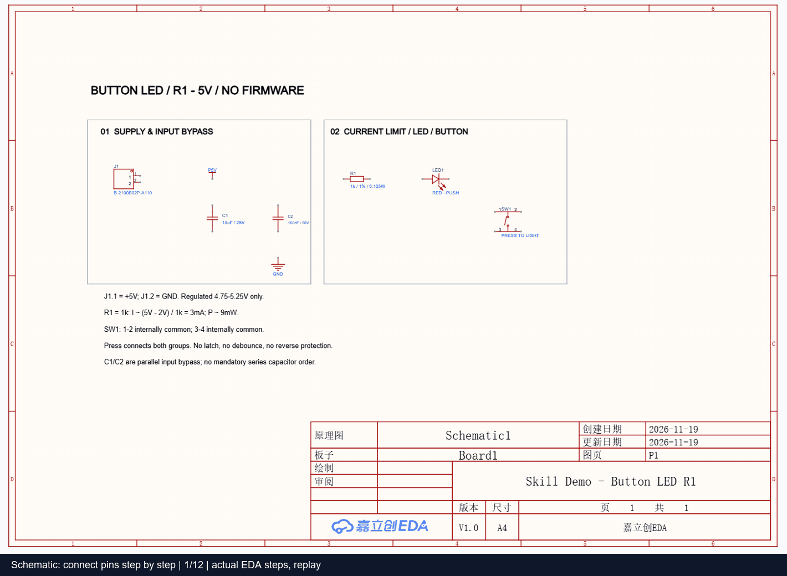
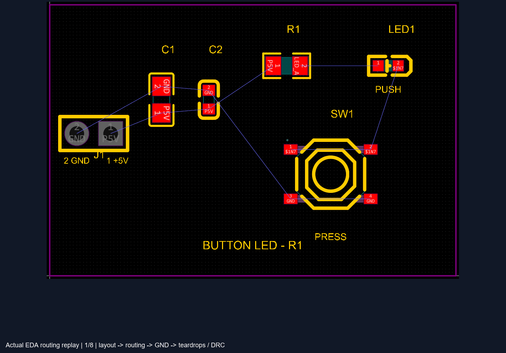
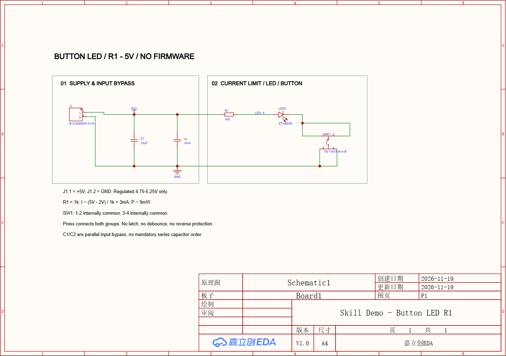
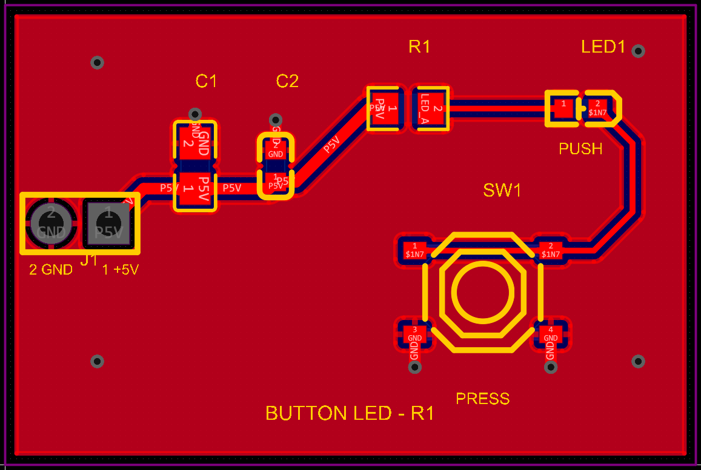

# 完整入门例子：5V按键控制LED板

日期2026-11-19，嘉立创EDA专业版V4.1.60。独立新建教学工程，无固件。按下按钮亮红灯，松开熄灭。此例用于观察从器件、引脚和电气计算到原理图、PCB、生产输出的完整路径；它不覆盖RF、FPC或高速差分实板能力。

## 先看连接过程

原理图动画只保留完整图纸，不含菜单/工程树/属性/DRC区域。逐段创建实际导线并采集画面，标记为设计过程回放；不是首次连续录屏。局部变化较小时可打开原图查看。PCB动画按供电、LED、按钮、GND铺铜顺序展示。

## 功能和接口

- 输入：外部稳压5V，教学工作范围4.75～5.25V；J1.1为+5V、J1.2为GND。不可直接接12V或不受控锂电池组。
- 输出：板载红色LED，按住亮、松手灭，无锁存、无软件、无通信。
- 原理：J1.1→R1→LED阳极/阴极→SW1→GND→J1.2形成闭合回路；松开SW1时直流路径断开。
- C1和C2并联跨接输入与地。它们演示储能/旁路布局，不是必需的按键消抖网络，不参与设定LED电流；本板无MCU，不能据此评估逐MCU电源脚去耦能力。
- 机械：1200×800mil，即30.48×20.32mm；两层板，顶面器件和短走线，双面GND铺铜/缝合。无既有外壳或安装孔约束，未添加螺丝孔。

## 每个器件为什么存在

| 位号 | 型号/供应商编号 | 作用与关键核对 |
|---|---|---|
| J1 | B-2100S02P-A110 / C124375，1×2、2.54mm排针 | 接外部电源；针1=5V、针2=GND，按实际焊盘/观察方向标注。开放排针无防呆，接线需核对极性 |
| R1 | 0805W8F1001T5E / C17513，1kΩ±1%、0.125W | 串联限制LED电流；不能用铜线跨过电阻，检查两端属于不同网络 |
| LED1 | KT-0603R / C2286，红色0603 | 电能转为光；1=A阳极，2=K阴极，以实际符号/封装核对极性 |
| SW1 | TS-1187A-B-A-B / C318884，5.1×5.1mm轻触 | 1/2内部相通、3/4内部相通；按下跨接两组。不能按“四脚开关都一样”猜脚号 |
| C1 | CL21A106KAYNNNE / C15850，10µF、25V、X5R、0805 | 输入储能/旁路示例。标称容量不等于5V偏压有效容量，本例不以它满足特定瞬态指标 |
| C2 | CC0603KRX7R9BB104 / C14663，100nF、50V、X7R、0603 | 输入高频旁路示例；与C1并联，不是让直流串过电容。路径与回地比“大到小”外观更重要 |

采购资料来自实际库的准确型号及其数据手册链接，库字段仍需购买前复核。小电容和LED为0603，初学手焊需要镊子、放大和合适焊尖；希望更易手焊可设计独立0805/通孔变体，不能在本例未改封装时宣称全0805。

## 电气计算

假设输入5V、LED工作点压降2V：`I=(5-2)/1000=3mA`；电阻功耗`I²R=9mW`。rftools-mcp 2.11.3的led-resistor本地计算器实际得到1kΩ、3mA和9mW，和独立公式一致。

Vf随电流/温度/批次改变，库给的1.8～2.4V不能直接当3mA保证范围。为检查R1/开关负担，可以采用更保守上界Vf≥0：5.25V及R最低990Ω时，电流≤5.31mA、电阻功耗≤27.9mW，低于标称125mW（仍需按环境温度降额）。这个电气上界不证明LED光强/颜色/人体可见性，亮度待样机观察。开关库额定50mA/12V明显高于本例直流负载；机械寿命不由本次验证。

20mil供电路径为用户默认和易布局选择，不是3mA必须用20mil。按35µm铜、20mil宽、正向50mm的保守估算，电阻约0.05Ω；5.31mA时压降约0.27mV。完整回路还包含排针、按键接触、焊点和GND铜，最终电压和温升仍需实测。

## 原理图步骤

1. 定义输入/功能/验收，选独立小项目，保护其他项目。
2. 从真实库查器件，核对MPN、符号引脚、封装焊盘及3D关联。
3. 将输入/旁路、电阻/LED/开关分为两块，供电在上、地在下，关键串联路径直接可见。
4. 逐条连接端点，连续同网只保留必要名称；开关内部两组连接和所有实体脚均核对。
5. 导出逐脚网表；J1的镜像/旋转必须与文字定义一致。完成标准属性/符号/封装身份校正，再检查。
6. 运行原生原理图DRC；本例最终记录0错误、0警告。该结果不等于器件采购认证或实测通过。

本轮实际发现并修复了6处引脚/焊盘关联错误、重复网名和标准化警告。原因包括直接替换otherProperty覆盖项目库UUID、API返回值与画面/源文件不同步；这些属于自动化问题，不能通过关掉DRC规则解决。

## PCB布局与布线步骤

1. 采用两层，板框固定；J1靠边，LED便于观察，按钮留操作空间。器件之间保留本体/焊盘和手焊工具空间。
2. 输入电容靠近输入通道，正向路径短；顶层20mil电源，LED/开关支路10mil，节点间同宽。所有真实连接端点从焊盘读取。
3. 先非GND连接，普通转角45°。一处C2旁电源过近，通过移开路径恢复6mil间距，未降低规则。
4. 局部电容/开关地使用短线至就近12/24mil过孔，双面GND铺铜并按连通/回流放缝合孔；重铺后无未连接。
5. 原理图和PCB导入修改同步；完整DRC首次通过后添加11处适用泪滴，重铺并再次运行完整DRC。
6. 字体Arial，排针逐脚功能、LED用途和按钮功能标识；核对Gerber中的字形/开窗/板框。
7. 原生工程、Gerber、钻孔和逐脚网表保存同修订。生产钻孔确认排针约1.10002mm、过孔0.3048mm；发现API孔字段存在倍率差异，因此没有只靠API字段认定孔径。

## 本例怎样评估Skill

| 能力 | 本例证据/边界 |
|---|---|
| 工程/任务识别 | 独立工程、6器件14引脚、4网络；common/PCB/power/silkscreen模块 |
| 原理图设计 | 真实符号/焊盘映射、完整网表、原生DRC；出现错误后实际修复，未隐藏 |
| PCB设计 | 真正两层布局、短线、GND铜与过孔、11泪滴和当前修订DRC |
| 本地计算工具 | rftools握手/工具发现/LED计算实测；未做远程仿真 |
| 说明图工具 | drawio握手、10工具发现、叠层XML生成；SVG仅占位，未当作有效渲染 |
| 自动路由 | 脚本测试普通板、四层混合板、RF/FPC触发、未知分类、缺证据、过期快照与篡改清单；不是对应实板认证 |
| RF/FPC/高速实板 | 本例没有这些对象，尚未验证，需各自专题例子 |
| 样机/EMC/热/寿命 | 未制造、未上电、未测量，保持待验证 |

不设置无依据的“Skill能力90分”。分别报告功能已演示、工具已验证、流程未满足和实板未覆盖项。已有DRC不能替代PCB-V07装配/逐脚回路记录；本例首次试布遗漏了前置阶段检查，已在相同布局上重新执行真实布局门禁后再逐步恢复最终布线，分别保存布局与最终证据；不追溯伪造首次流程通过。

## 使用和后续扩展

复现时在嘉立创EDA新建独立工程，先读[完整指南](V3_GUIDE.md)，生成本板inventory和规则清单。以后可以依次增加：三极管/MOS LED驱动→MCU按键/去耦/下载→USB差分四层→RF模块/天线→FPC。每个案例只增加少量新风险，并提供对应独立验收。

发布包只含原创教程及本次新建教学图，不分发用户历史工程、资料附件或第三方MCP源码。实际可编辑EDA文件和生产输出存工作区案例目录，生产前仍需完成板厂/装配与样机检查。
