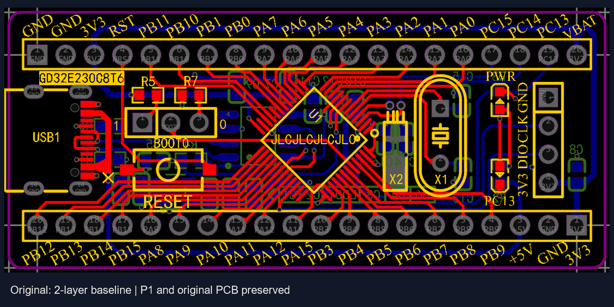
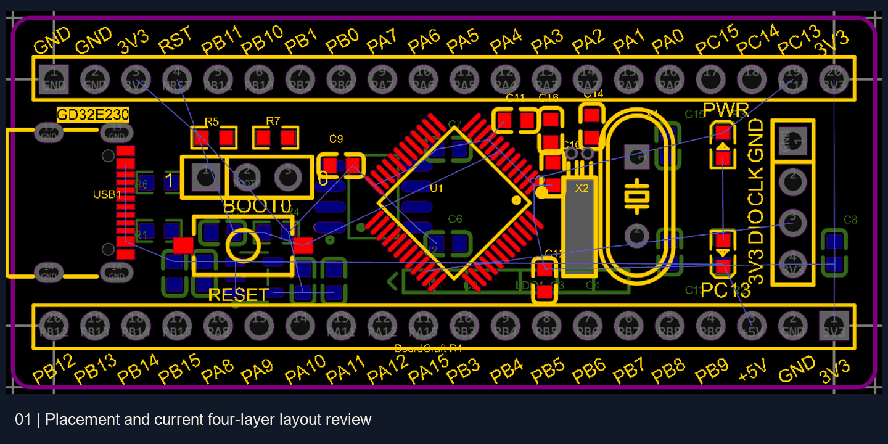

# 02 · GD32E230 开发板：PCB 对照设计

本例复用现有完整P1，只修改独立PCB副本。目标是展示规则如何落地、怎样检查以及哪些变化有代价；没有重画原理图，也不把“使用Skill”当作质量结论。

## 先看两版

原版2层、副本4层；GIF显示真实EDA状态切换，只有板框内容和说明栏。两版制造条件不同，不能直接用“过孔更少／线更短”决定谁更好。原版PCB与P1保留；副本名 `PCB_GD32E230_BoardCraft`。

## 板子的功能

- GD32E230C8T6：Cortex-M23、最高72MHz，负责GPIO、定时器、ADC及通信等应用；实际功能由固件决定。
- CH340N：USB转UART；USB连接到它，USART0连接MCU，不是MCU原生USB。
- ME6211C33M5G-N：5V转3.3V LDO，输入／输出旁路服务相应电源脚；额定值不能替代本板热设计和负载确认。
- USB-C：供电和USB-UART；CC电阻沿用原图，未擅自增加保护或改变网络。
- 8MHz、32.768kHz两颗晶体：分别服务高速外部时钟和低速时钟；两颗负载电容按既有振荡拓扑连接，不能套用电源电容大小顺序。
- RESET、BOOT0跳线、SWD及GPIO排针：用于复位、启动模式、下载／调试和外设扩展；PWR/PC13灯用途沿用原图。

## 哪些保持，哪些改变

| 对象 | 结果 |
|---|---|
| P1电路与所有网络 | 178个引脚项逐脚一致；52个非空网络 |
| 原版PCB | 非DOCHEAD设计记录一致；仅会话时间元数据随读取更新 |
| 板框 | 同为53.34×22.86mm圆角轮廓 |
| USB1、SW1、H1–H4 | 坐标、旋转、层及封装基准不变 |
| 板层 | 原版2层→副本4层，增加成本；不能说原版两层无法设计好 |
| MCU旁路 | C9/C10/C11/C12从底面移到顶面，逐脚分配并检查实际供电／完整回地 |
| 电源／GND | 优先20mil，受限真实节点间整段10mil；原版若干15mil段在副本整理为20/10mil |
| GPIO | 合适原路线复用，冲突局部重布，普通网络8mil最小；不为全面改样而删除所有好路线 |
| GND | 四层GND铜；Inner2不布信号，给底层USB提供邻近参考；先铺铜／孔，再处理残余未连接 |
| 丝印 | Arial、功能标注保留；原VBAT脚实接3V3，副本改标3V3，仅改PCB文字 |
| 收尾 | 53处适用泪滴→重铺铜→完整DRC零错误 |

### MCU去耦的具体比较

| 电源脚／电容 | 原版电容层 | 副本电容层 | 两焊盘直线距离 |
|---|---|---|---|
| U1.1 / C10 | Bottom | Top | 1.757 → 1.146 mm |
| U1.9 / C11 | Bottom | Top | 2.751 → 1.548 mm |
| U1.24 / C9 | Bottom | Top | 3.570 → 1.810 mm |
| U1.48 / C12 | Bottom | Top | 4.585 → 3.129 mm |

直线距离只是布局量，不证明去耦性能。实际铜路径分别约1.408、1.601、1.843和3.330mm，均Top层；完整回地已结合线段、过孔与实际地铜多边形核对。平面图模型只验证连通，不估算平面电感。U1.48路径和部分地回路仍有进一步改进空间。

### 不是每一项都更短

USB主路径复用原版：D+约15.947mm、D−约14.514mm，相差约1.433mm，各1个信号孔。没有按真实制造叠层计算90Ω，也没有眼图／TDR实测，不能宣称阻抗达标。Bottom走线下Inner2的131个离开信号孔反焊盘区采样点均有实际GND铜；这是几何检查，不能替代完整SI分析。

晶振网络在原图中也引到外部排针，存在分支；全网总长不是MCU到晶体的主路径。8MHz两网总长略增，32.768kHz两网总长下降，因此不声称晶振全部变短。X1是通孔金属壳体，C13/C15保留底层贴近其通孔脚，避免被壳体挡住。晶振起振裕量、外部排针负载和频偏保持待测。

## 看连接过程

这是最终真实布局的逐步回放：先移除副本铜路并运行当前四层布局证据门槛，再恢复关键通道、电源、普通网络、GND和泪滴；完成后恢复最终源、重铺并再次DRC。不是首次连续录屏；两层试验和先前阶段记录作为历史保留，不追溯伪造首次通过。

## 实际验证与局限

- 当前原生DRC `[]`、布尔通过；逐脚网表一致；板框／接口基准保持。
- 最终36器件真实本体无重叠、180独立物理焊盘无相交／贴边；四铜层同层非过孔90度组合为0；电源／GND连续节点间无混宽。
- 导出原生epro2、四层Gerber与钻孔；ZIP完整性及主要几何记录核对，G1/G2输出存在。
- 紧凑处仍有C14/X1约0.174mm、C10/X2约0.251mm本体间隙；需要考虑先焊小件、再装通孔晶体的工序，不能说手焊／返修便利性已验证。
- 板厂制造叠层／阻抗、MLCC偏压容量、最大外接负载、LDO热、晶振起振／温漂、USB波形、ESD／EMC、样机实测均未完成。本例是可审查的设计比较，**不是制造放行证明**。

## 来源与署名

原始电路与开发板：[立创·GD32E230开发板](https://oshwhub.com/li-chuang-kai-fa-ban/li-chuang-gd32e230-zui-xiao-xi-tong-ban)，归属立创开发板团队；当前页面创建者账号为“眉毛比头发还多的吴工”。[官方产品页](https://lckfb.com/project/detail/lc-gd32e230c8t6)直接关联该原项目。本例仅增加PCB布局／布线对照、核验记录和教程，原电路不是BoardCraft原创。

原页标注GPL 3.0，同时存在平台通用学习／非商业用途说明及allow_reprint:false元数据；这些并存表述不在本例中简化为完整转载／商业使用许可。公开页面仅呈现经本次任务制作的学习对比和原创说明；不把上游电路纳入本仓库CC BY-SA规则许可，不分发其PDF／完整原生电路工程。修改版可编辑工程与制造输出保留于用户本地案例目录。用于其他发布／生产目的前，应核对原作者和平台适用条件。

项目原始数据手册：[GD32E230xx Datasheet，准确器件资料](https://atta.szlcsc.com/upload/public/pdf/source/20191028/C380535_2A3608A1B122F87D1E8A29B0B3E313D6.pdf)。PDF页12核对LQFP48脚号，页36供电结构，页51–52晶振参数；不套用其他MCU家族参数。

[返回首页](../README.md) · [工具与引用](TOOLS.md) · [使用流程](V3_GUIDE.md)
